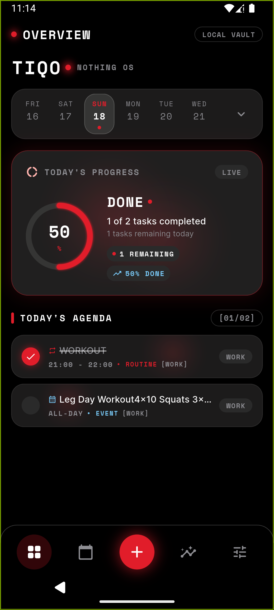
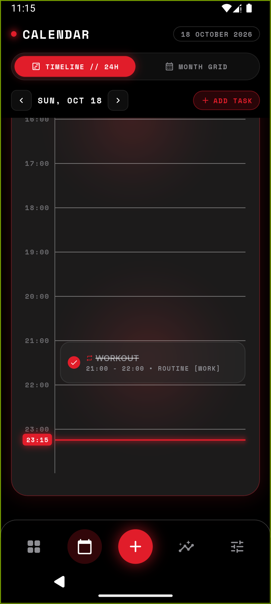
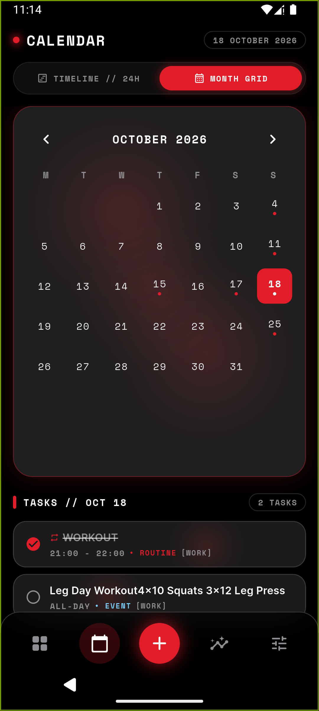
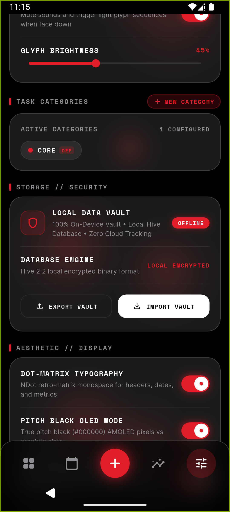

# TIQO - Minimalist Nothing Style Daily Planner

[](https://flutter.dev)
[](https://nothing.tech)
[](LICENSE)
[](#-local-data-vault--privacy)

> **TIQO** is an open-source, privacy-focused daily planner and productivity app built with Flutter. Designed with obsessive attention to the **Nothing design philosophy**: retro dot-matrix typography, monochrome surfaces with Nothing Crimson (`#E11D2A`) accents, true pitch-black OLED pixels, and an atmospheric firefly glow.

---

## 📱 Screenshots

| Home & Agenda | 24H Timeline Schedule | Month Matrix | Settings & Vault |
|:---:|:---:|:---:|:---:|
|  |  |  |  |

---

## 💡 A Word from the Creator

> *Hey everyone!*  
> *I want to be completely open and transparent: I am not a professional software engineer or programmer. I built TIQO because I love Nothing's design philosophy and wanted a task manager and daily schedule that felt genuinely native to Nothing Phone - minimal, tactile, offline, and distraction-free.*
>
> *I used AI pair-programming to help write the code. I know AI-assisted coding can be a sensitive topic in the developer community, and I apologize if that's not everyone's cup of tea. But for me, it was an incredible opportunity to turn an idea into an actual working product that I use every single day on my own phone. Everything in TIQO - from the glyph matrix triggers and the drifting fireflies to the local JSON data vault - was conceived out of a desire for something functional, beautiful, and respectably private. I hope you enjoy using it as much as I enjoyed bringing it to life!*

---

## ✨ Features

### 📅 Three Dimensions of Planning
- **Single Tasks**: Focused, one-time to-dos with scheduled start times, minute-precise durations, reminders, and Pomodoro focus timers.
- **Routine Tasks**: Repeating weekly habits (e.g., Every Monday, Wednesday, Friday) with isolated daily completion states.
- **Events & Recurrences**:
  - **Multi-day Events**: Select any single date or range of calendar dates.
  - **Yearly Events (Annual)**: Perfect for birthdays, anniversaries, and holidays that repeat on the same month & day every year.
  - **Monthly Events**: Repeats on the same calendar day every month.
  - **Per-Date Completion Tracking**: Checking off an annual or monthly event in 2026 marks only that specific occurrence, keeping previous and future occurrences clean.

### ⏱️ Interactive Timeline & Calendar Matrix
- **24-Hour Timeline Schedule**: Scrollable hourly dispatch grid with real-time crimson indicator line, current time display, and time-block cards.
- **5-Week Month Grid**: Clean matrix view showing dates with active tasks, routines, and events, complete with day-by-day task lists.
- **Distinct Visual Hierarchy**: Clear separation between task types (`• ROUTINE`, `• EVENT`, `• ANNUAL EVENT`) and category badges (`[CORE]`, `[WORK]`).

### 🔴 Atmospheric Glow Matrix
- Four organic firefly light emitters drifting gently behind frosted glass cards and timeline widgets.
- Seamless, continuous looping motion with natural asymmetry and soft Gaussian blur.
- Fully toggleable in Settings with zero impact on battery efficiency.

### 🛡️ Local Data Vault & 100% Privacy
- **Zero Cloud Tracking**: 100% on-device local storage powered by Hive. No accounts, no analytics, no external servers.
- **JSON Export**: Export your complete task registry, custom categories, and completion history to formatted JSON with one-tap clipboard copying.
- **Non-Destructive Import (`MERGE & APPEND`)**: Dogfood templates or transfer routines from another device without losing your existing tasks. Automatically handles ID collisions and creates missing categories.
- **Full Database Restore (`RESTORE`)**: Full system restore with a Nothing OS confirmation dialog.
- **Prompt & Template Ready**: Easily feed templates into AI tools (e.g. asking ChatGPT to format public holidays) and paste directly into TIQO.

### ⚙️ Hardware & Aesthetics
- **Nothing Glyph Interface Sync**: Optional LED matrix integration for Nothing Phone hardware (customizable brightness, flash sequences, and Flip-to-Glyph).
- **Pitch-Black OLED Mode**: Pure `#000000` AMOLED optimization to minimize power draw.
- **Permanent `CORE` Default Category**: Safe non-deletable default category with support for custom colored taxonomy chips.

---

## 📥 Download & Installation

### Option 1: Download Release APK (Recommended)
Grab the latest signed `.apk` directly from the [GitHub Releases](https://github.com/Aseprit/Tiqo/releases) page and install it on your Android device.

### Option 2: Build from Source
If you want to build the project from source:

1. **Clone the repository**:
   ```bash
   git clone https://github.com/Aseprit/Tiqo.git
   cd Tiqo
   ```

2. **Install Flutter dependencies**:
   ```bash
   flutter pub get
   ```

3. **Run on connected device / emulator**:
   ```bash
   flutter run
   ```

4. **Build release APK**:
   ```bash
   flutter build apk --release
   ```
   The compiled APK will be located at `build/app/outputs/flutter-apk/app-release.apk`.

---

## 🛠️ Architecture & Tech Stack

- **Framework**: [Flutter](https://flutter.dev) (Dart 3.x)
- **Target Platform**: Android (optimised for Nothing Phone and Nothing design language)
- **State Management**: [Riverpod](https://pub.dev/packages/flutter_riverpod)
- **Local Persistence**: [Hive](https://pub.dev/packages/hive_flutter)
- **Navigation**: [GoRouter](https://pub.dev/packages/go_router)
- **Typography**: NDot 57 retro dot-matrix & clean sans typography via [Google Fonts](https://pub.dev/packages/google_fonts)

---

## 📄 License

This project is licensed under the MIT License - see the [LICENSE](LICENSE) file for details.
